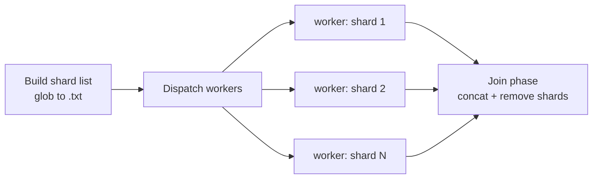

# RVDB_Parallel

Parallelized production scripts for the Reference Viral DataBase (RVDB) update pipeline.

The RVDB update was originally a sequence of single-threaded Python scripts. On a full GenBank release, the three heaviest stages dominate total runtime. This repository replaces those three stages with file-level parallel equivalents that shard the work by input file and dispatch one job per shard.

| Original serial script | Replaced by | Parallel Python backend |
|---|---|---|
| `VDBunzip_reformat_gb_to_fasta_PIPE.py` | `step1` + `step2` wrappers | `VDBunzip_reformat_gb_to_fasta_PIPE_parallel.py` |
| `VDBupdate_checkpoint2_PIPE.py` | folded into the `step2` wrapper | *(as above)* |
| `SEM-R_june62018_PIPE.py` | six `step3` wrappers — `{poskw, sizemirna, negkw} × {gb, tpa}` | `SEM-R_aug2025_PIPE_parallel.py` |

Everything else in the RVDB update — RefSeq parsing, TPA unzipping, phage cleanup, list generation — remains unchanged and runs serially.

---

## Choose your version

Two implementations are provided. They perform identical work and produce identical output; they differ only in how jobs are scheduled and where they run.

| | **Standalone** | **Slurm** |
|---|---|---|
| Target platform | A single workstation or server | An HPC cluster with the Slurm workload manager |
| Scheduler | GNU Parallel (`-j N` local jobs) | Slurm, submitted with `sbatch` |
| Scope of parallelism | Cores within one machine | Across allocated cluster nodes |
| How you run it | Interactively, one command at a time | Submit and monitor through the queue |
| Best when | You have one large multi-core node and want direct control | You have cluster access and are processing a full release |
| **Documentation** | **[Standalone/README.md](https://github.com/ArifaKhanLab/RVDB_Parallel/blob/main/Standalone/README.md)** | **[Slurm/run_slurm_pipeline.sh.md](https://github.com/ArifaKhanLab/RVDB_Parallel/blob/main/Slurm/README.md)** |

> **Not sure?** Start with the Standalone version. It has fewer moving parts, its stages can be run and inspected one at a time, and it requires no scheduler configuration. Move to the Slurm version when a single node is no longer sufficient.

Each version's README is self-contained: prerequisites, parameters, per-stage commands, expected outputs, and troubleshooting. Read the one for your platform rather than mixing instructions between them.

---

## Repository layout

```
RVDB_Parallel/
├── README.md                 # this file
├── Standalone/               # GNU Parallel version, single machine
│   └── README.md
└── Slurm/                    # Slurm version, HPC cluster
    └── run_slurm_pipeline.sh.md
```

---

## Common prerequisites

Both versions share the same computational core and therefore the same base requirements.

| Requirement | Notes |
|---|---|
| **Python 3.12** | Runs the `*_parallel.py` backends. |
| **Bash 4+** | Uses `export -f`, `[[ ]]`, `local`, `$SECONDS`. |
| **GNU coreutils / findutils** | `stat -c`, `df -P`, `find -printf` are GNU-specific. Not portable to BSD or macOS without `coreutils` and `findutils` installed. |
| **A tmpfs RAM disk** (`/dev/shm`) | Used to stage shards. Workers fall back to on-disk processing when space is short. |
| **RVDB Python 3 pipeline** | The unchanged serial scripts and the parallel backends, under `rvdb_update_pipeline/`. |

Version-specific requirements — GNU Parallel for Standalone, a configured Slurm partition for the cluster version — are listed in the respective READMEs.

### Python environment

Both versions expect the `rvdb_pipeline` environment used by [RVDB_PY3](https://github.com/ArifaKhanLab/RVDB_PY3), created from the `rvdb_py3.yaml` file in that repository:

```bash
mamba env create -n rvdb_pipeline -f rvdb_py3.yaml
conda activate rvdb_pipeline
```

Verify before running anything:

```bash
python --version
df -h /dev/shm
```

---

## Key parameters

Three values drive every stage in both versions. Decide them before you begin.

| Parameter | Example | Meaning |
|---|---|---|
| **Version** | `30.0` | RVDB version assigned to this update. Names the `RVDBv<VERSION>/` working tree. |
| **Date tag** | `may.2025` | **`month.year` only** — lowercase three-letter month, dot, four-digit year. Tags every directory and output filename. |
| **Job count** | `50` | Concurrent workers. Interpreted as GNU Parallel's `-j` in the Standalone version, and as a Slurm resource request in the cluster version. |

> ⚠️ **The date tag is not a full calendar date.** Every glob in every stage embeds this string, so a mismatch produces empty file lists rather than an error message. If a stage runs but produces nothing, check the date tag first.

> ⚠️ **Argument order is not uniform across the wrappers.** The `step1`/`step2` scripts and the `step3_*` scripts take their three arguments in different orders, and passing them the wrong way round fails silently. Each version's README documents the exact order per script — follow it literally.

---

## How the parallelization works

Every wrapper in both versions follows the same five-part pattern.



1. **Shard list.** A glob over the previous stage's output directory writes one input basename per line to a list file. This file is the fastest way to diagnose a stage that appears to do nothing.
2. **Worker dispatch.** One job per shard, capped at the configured job count.
3. **RAM-disk staging.** Each worker compares its shard size against free space on `/dev/shm`, then either copies the shard to tmpfs or falls back to the on-disk copy. Fallback is slower but correct.
4. **Backend invocation.** The Python backend is called with an identical command line in every job; the per-shard target is passed through exported environment variables. **Any modification to the backends must preserve those variable names**, or every worker will process the same file.
5. **Join.** Per-shard header files are concatenated into one file per category and the shards deleted.

---

## Pipeline stage order

The screening stages are chained — each consumes the previous stage's output — so they must run in this order for GenBank and again for TPA:

```
GenBank flat files
  └─ step1  decompress
       └─ step2  reformat to FASTA
            └─ step3 poskw      positive keyword screen
                 └─ step3 sizemirna   size / miRNA screen
                      └─ step3 negkw      negative keyword screen
```

| Stage | Reads | Writes |
|---|---|---|
| `poskw` | `<division>.seq.<DATE>` | `poskw_out_<DATE>/*.pscreen.fasta`, `headers_pscreen.txt` |
| `sizemirna` | `*.pscreen.fasta` | `sizemirna_out_<DATE>/*.sizemirnascreenOK.fasta`, `headers_sizemirna{FLAG,OK}.txt` |
| `negkw` | `*.sizemirnascreenOK.fasta` | `negkw_out_<DATE>/headers_nscreen{AMB,DUP,FLAG,OK,VRL}_<VERSION>.txt` |

The TPA chain is identical, operating on `*tpa_cu*` inputs under the TPA working directory.

---

## Related repositories

| Repository | Contents |
|---|---|
| [ArifaKhanLab/RVDB](https://github.com/ArifaKhanLab/RVDB) | Original RVDB update and characterization scripts (Python 2). |
| [ArifaKhanLab/RVDB_PY3](https://github.com/ArifaKhanLab/RVDB_PY3) | Python 3 rewrite of the production pipeline, with the `rvdb_py3.yaml` environment definition. |
| **ArifaKhanLab/RVDB_Parallel** | *(this repository)* Parallelized wrappers for the three heaviest stages. |

The database releases themselves are distributed at <https://rvdb.dbi.udel.edu/>.

---

## Citation

If you use RVDB or these pipeline scripts, please cite:

> Goodacre N, Aljanahi A, Nandakumar S, Mikailov M, Khan AS. 2018. A reference viral database (RVDB) to enhance bioinformatics analysis of high-throughput sequencing for novel virus detection. *mSphere* 3:e00069-18. <https://doi.org/10.1128/mSphereDirect.00069-18>

and, for the refined Python 3 pipeline:

> Refinement of the Reference Viral Database (RVDB) for improving bioinformatics analysis of virus detection by high-throughput sequencing (HTS). *mSphere*. <https://doi.org/10.1128/msphere.00286-25>

---

## License

This is a work of the U.S. Government and is not subject to copyright protection in the United States. Foreign copyrights may apply.
