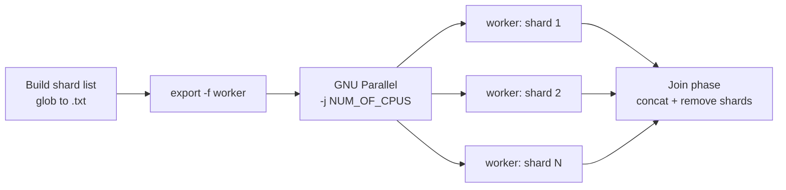

# RVDB Parallelized Production Pipeline Scripts (Standalone Version)

GNU Parallel wrappers that replace three single-threaded Python stages of the RVDB Module 1 update pipeline with file-level parallel equivalents.

| Original serial script | Replaced by | Parallel Python backend |
|---|---|---|
| `VDBunzip_reformat_gb_to_fasta_PIPE.py` | `step1.sh` + `step2_v4_3.sh` | `VDBunzip_reformat_gb_to_fasta_PIPE_parallel.py` |
| `VDBupdate_checkpoint2_PIPE.py` | folded into `step2_v4_3.sh` | *(as above)* |
| `SEM-R_june62018_PIPE.py` | `step3_{poskw,sizemirna,negkw}_{gb,tpa}_v2.sh` | `SEM-R_aug2025_PIPE_parallel.py` |

Each wrapper shards the work by input file, dispatches one GNU Parallel job per shard, stages shards on a RAM disk when space allows, and concatenates the per-shard outputs at the end.

The stages are designed to be run **one command at a time**, checking the output of each before moving to the next.

---

## Contents

- [Prerequisites](#prerequisites)
- [Repository layout](#repository-layout)
- [Key parameters](#key-parameters)
- [Argument order — read this first](#argument-order--read-this-first)
- [How the parallelization works](#how-the-parallelization-works)
- [Usage](#usage)
- [Stage-by-stage data flow](#stage-by-stage-data-flow)
- [Logs](#logs)
- [Tuning](#tuning)
- [Known issues and gotchas](#known-issues-and-gotchas)


---

## Prerequisites

### Required

| Tool | Notes |
|---|---|
| **GNU Parallel** | The scheduler for every stage. `parallel --version` must report *GNU parallel*, not the `moreutils` `parallel`. |
| **Bash 4+** | Uses `export -f`, `[[ ]]`, `local`, `$SECONDS`. |
| **GNU coreutils** | `stat -c` and `df -P` are GNU-specific. Not portable to BSD/macOS as-is. |
| **GNU findutils** | `step1.sh` uses `find -printf`. |
| **Python 3.12** | Runs the `*_parallel.py` backends. |
| **`/dev/shm`** | tmpfs RAM disk used for shard staging. Must exist and be writable. |

### Environment

The reference deployment uses a `mamba`/`conda` environment named `rvdb_pipeline`. Activate it before running anything:

```bash
source /path/to/your/miniforge3/etc/profile.d/conda.sh
conda activate rvdb_pipeline
```

### Verify before you start

```bash
parallel --version | head -1
python --version
df -h /dev/shm
nproc
```

If `parallel --version` prints nothing about GNU, you have the wrong `parallel` on your `PATH` and every stage will fail in confusing ways.

---

## Repository layout

The wrappers resolve paths relative to the **current working directory**, so every command below must be run from the project root:

```
<project root>/                     # HOMEDIR = $(pwd)
├── config.sh                       # shared environment (sourced by step3_* only)
├── step1.sh
├── step2_v4_3.sh
├── step3_poskw_gb_v2.sh
├── step3_sizemirna_gb_v2.sh
├── step3_negkw_gb_v2.sh
├── step3_poskw_tpa_v2.sh
├── step3_sizemirna_tpa_v2.sh
├── step3_negkw_tpa_v2.sh
├── rvdb_update_pipeline/           # Python backends live here
│   ├── VDBunzip_reformat_gb_to_fasta_PIPE_parallel.py
│   └── SEM-R_aug2025_PIPE_parallel.py
└── RVDBv<VERSION>/                 # working tree for one update
    ├── GB_phg/
    ├── files_to_process.txt        # written by step1.sh, reused by step2
    ├── GenBank_raw_data_<DATE>/
    │   ├── log/  scripts/
    │   ├── poskw_out_<DATE>/
    │   ├── sizemirna_out_<DATE>/
    │   └── negkw_out_<DATE>/
    ├── RefSeq_raw_data_<DATE>/
    │   └── log/  scripts/
    └── TPA_raw_data_<DATE>/
        ├── log/  scripts/
        ├── poskw_out_<DATE>/
        ├── sizemirna_out_<DATE>/
        └── negkw_out_<DATE>/
```

Running from anywhere else silently produces wrong paths — `HOMEDIR=$(pwd)` in `config.sh` has no validation.

---

## Key parameters

Three values drive everything. Decide them before you start.

| Parameter | Example | Meaning |
|---|---|---|
| `NUM_OF_CPUS` | `50` | Concurrent GNU Parallel jobs (`-j`). See [Tuning](#tuning). |
| `DATE` / `DATETAG` | `may.2025` | **`month.year` only.** Tags every directory and output filename. |
| `CURRENTVS` / `VERSION` | `30.0` | RVDB version for this update. Names `RVDBv<VERSION>/`. |

> **On the date format.** The date tag is `month.year` — lowercase three-letter month, a dot, and the four-digit year (`may.2025`, `jun.2025`). It is not a full calendar date. Every glob in every stage embeds this string, so a mismatch produces empty file lists rather than an error message.

### What `config.sh` derives

`config.sh` takes `$1 $2 $3` and exports the full directory tree:

```bash
NUM_OF_CPUS=$1
DATE=$2
CURRENTVS=$3

HOMEDIR=$(pwd)
WDIR=$HOMEDIR/RVDBv$CURRENTVS
GBDIR=$WDIR/GenBank_raw_data_$DATE
TPADIR=$WDIR/TPA_raw_data_$DATE
REFSEQDIR=$WDIR/RefSeq_raw_data_$DATE

POSKW_OUTDIR=$GBDIR/poskw_out_$DATE               # consumed by step3_sizemirna_gb
SIZEMIRNA_OUTDIR=$GBDIR/sizemirna_out_$DATE       # consumed by step3_negkw_gb
POSKW_TPA_OUTDIR=$TPADIR/poskw_out_$DATE          # consumed by step3_sizemirna_tpa
SIZEMIRNA_TPA_OUTDIR=$TPADIR/sizemirna_out_$DATE  # consumed by step3_negkw_tpa
```

The trailing comments name the script that *reads* each directory — that is what encodes the stage chaining.

`config.sh` is sourced by the six `step3_*` scripts only. `step1.sh` and `step2_v4_3.sh` set their own paths inline and take the same three values on the command line, **in a different order**.

---

## Argument order — read this first

**`step1`/`step2` and `step3_*` take their three arguments in opposite orders.** This is the most common way to break a run, and it fails quietly: you get empty file lists and zero-byte outputs rather than an error.

| Script | `$1` | `$2` | `$3` |
|---|---|---|---|
| `step1.sh` | `VERSION` | `DATETAG` | `NUM_OF_CPUS` |
| `step2_v4_3.sh` | `VERSION` | `DATETAG` | `NUM_OF_CPUS` |
| `step3_*_v2.sh` | **`NUM_OF_CPUS`** | `DATE` | **`VERSION`** |

The `step3_*` order exists because those scripts forward `$1 $2 $3` straight into `source ./config.sh`, which expects the CPU count first.

---

## How the parallelization works

All eight wrappers follow one pattern:



**1. Shard list.** A glob over the previous stage's output directory writes one basename per line to a list file in the project root:

```bash
FASTA_LIST=list_fasta.txt
rm -f $FASTA_LIST
for file in $GBDIR/gb*.seq.$DATE; do
  echo "${file##*/}" >> $FASTA_LIST
done
```

**2. Worker function.** A shell function (`process_file`, `process_dir`, `process_fasta`, `process_pscreen`, `process_sizemirna`, and their `_tpa` variants) is defined and exported so Parallel can invoke it in each child shell:

```bash
export -f process_fasta
time parallel -j $NUM_OF_CPUS process_fasta ::: $(cat $FASTA_LIST)
```

**3. RAM-disk staging.** Each worker `stat`s its shard, compares the size against free space on `/dev/shm` (`df -P`), and either copies the shard to tmpfs or falls back to the on-disk copy. `step2_v4_3.sh` adds a 10 % headroom margin:

```bash
BUFFER_SIZE=$((FILE_SIZE / 10))
REQUIRED_SPACE=$((FILE_SIZE + BUFFER_SIZE))
```

The RAM-disk copy is removed at the end of the worker. Copy elapsed time is logged in nanoseconds, milliseconds and seconds.

**4. Shard identity is passed through the environment.** Every worker invokes the Python backend with an *identical* command line:

```bash
python $PY_SCRIPT $HOMEDIR $DATE $CURRENTVS $SCREENTYPE $SEQTYPE
```

The per-shard target is passed through exported environment variables instead — `EXTRACTED_FILE` and `OUT_FILE` in step 2, and `FASTA_FULL_PATH`, `PSCREEN_FULL_PATH`, `SIZEMIRNA_FULL_PATH`, `RAM_*_FILE` in step 3. **Any modification to the Python backends must preserve these variable names**, or the workers will all process the same file.

**5. Join.** After Parallel drains, per-shard header files are concatenated into one file per category and the shards deleted:

| Stage | Shard prefix | Joined output | Categories |
|---|---|---|---|
| poskw | `headers_pscreen_*` | `headers_pscreen.txt` | — |
| sizemirna | `headers_sizemirna<CAT>_*` | `headers_sizemirna<CAT>.txt` | FLAG, OK |
| negkw | `headers_nscreen<CAT>_<VER>_*` | `headers_nscreen<CAT>_<VER>.txt` | AMB, DUP, FLAG, OK, VRL |

The join phase is timed separately from the parallel phase in `log_script.txt`.

---

## Usage

Run these one line at a time from the project root, checking the result of each before continuing.

### 0. Activate the environment and set your parameters

```bash
conda activate rvdb_pipeline

RVDB_VER=30.0
RVDB_DATE=jun.2025
RVDB_CPUS=50
```

These three shell variables are for your convenience only — the scripts read positional arguments, not the environment.

### 1. Create the working tree

```bash
mkdir -p RVDBv$RVDB_VER/GB_phg
mkdir -p RVDBv$RVDB_VER/GenBank_raw_data_$RVDB_DATE/{log,scripts,poskw_out_$RVDB_DATE,sizemirna_out_$RVDB_DATE,negkw_out_$RVDB_DATE}
mkdir -p RVDBv$RVDB_VER/RefSeq_raw_data_$RVDB_DATE/{log,scripts}
mkdir -p RVDBv$RVDB_VER/TPA_raw_data_$RVDB_DATE/{log,scripts,poskw_out_$RVDB_DATE,sizemirna_out_$RVDB_DATE,negkw_out_$RVDB_DATE}

find RVDBv$RVDB_VER -maxdepth 2 -type d
```

The `*_out_<DATE>` directories must exist before the corresponding stage runs — the wrappers write into them but do not create them.

### 2. Stage the raw input data

Before running anything below, the raw NCBI downloads must be in place:

| Directory | Contents | Source |
|---|---|---|
| `GenBank_raw_data_<DATE>/` | `gb{env,htc,inv,mam,pln,pri,rod,vrl,vrt}*.seq.gz` | `ftp.ncbi.nlm.nih.gov/genbank` |
| `GB_phg/` | `gbphg*.seq.gz` | `ftp.ncbi.nlm.nih.gov/genbank` |
| `RefSeq_raw_data_<DATE>/` | `*.genomic.*.gz` | `ftp.ncbi.nlm.nih.gov/refseq/release/viral/` |
| `TPA_raw_data_<DATE>/` | `*nt.gz` | `ftp.ncbi.nlm.nih.gov/tpa/release` |

Confirm before proceeding:

```bash
ls RVDBv$RVDB_VER/GenBank_raw_data_$RVDB_DATE/*.gz | wc -l
```

### 3. Parse RefSeq (serial)

```bash
python rvdb_update_pipeline/parse_raw_refseq_PIPE.py    . $RVDB_DATE $RVDB_VER viral.1.1.genomic.fna.gz
python rvdb_update_pipeline/multiple_gzunzip_PIPE.py    . $RVDB_DATE $RVDB_VER viral.1.genomic.gbff.gz viral.genomic.gbff
python rvdb_update_pipeline/fileops_PIPE.py             . $RVDB_DATE $RVDB_VER gbff 1000000
python rvdb_update_pipeline/rs_acc_mapping_PIPE.py      . $RVDB_DATE $RVDB_VER
```

### 4. Decompress GenBank flat files — `step1.sh`

Argument order: **version, date, threads.**

```bash
time bash step1.sh $RVDB_VER $RVDB_DATE $RVDB_CPUS
```

Check that the file list was built and the archives were expanded:

```bash
wc -l RVDBv$RVDB_VER/files_to_process.txt
ls RVDBv$RVDB_VER/GenBank_raw_data_$RVDB_DATE/*.seq | wc -l
```

### 5. Reformat GenBank flat files to FASTA — `step2_v4_3.sh`

Argument order: **version, date, threads.** Reuses `files_to_process.txt` from step 1.

```bash
time bash step2_v4_3.sh $RVDB_VER $RVDB_DATE $RVDB_CPUS
```

Check the per-shard logs and the reformatted output:

```bash
ls RVDBv$RVDB_VER/GenBank_raw_data_$RVDB_DATE/logs_step2/ | head
ls RVDBv$RVDB_VER/GenBank_raw_data_$RVDB_DATE/*.seq.$RVDB_DATE | wc -l
```

### 6. SEM-R screening, GenBank — three stages, in order

Argument order flips here: **threads, date, version.** Each stage consumes the previous stage's output, so run them one at a time and confirm each produced files before continuing.

```bash
time bash step3_poskw_gb_v2.sh     $RVDB_CPUS $RVDB_DATE $RVDB_VER
wc -l list_fasta.txt
ls RVDBv$RVDB_VER/GenBank_raw_data_$RVDB_DATE/poskw_out_$RVDB_DATE/*.pscreen.fasta | wc -l
```

```bash
time bash step3_sizemirna_gb_v2.sh $RVDB_CPUS $RVDB_DATE $RVDB_VER
wc -l pscreen_list.txt
ls RVDBv$RVDB_VER/GenBank_raw_data_$RVDB_DATE/sizemirna_out_$RVDB_DATE/*.sizemirnascreenOK.fasta | wc -l
```

```bash
time bash step3_negkw_gb_v2.sh     $RVDB_CPUS $RVDB_DATE $RVDB_VER
wc -l list_sizemirna.txt
ls RVDBv$RVDB_VER/GenBank_raw_data_$RVDB_DATE/negkw_out_$RVDB_DATE/headers_nscreen*_$RVDB_VER.txt
```

If a stage reports one job and one failure, inspect its list file first — see [Known issues](#known-issues-and-gotchas).

### 7. Parse TPA (serial)

```bash
time python rvdb_update_pipeline/VDBunzip_tpa_PIPE.py . $RVDB_DATE $RVDB_VER fsa_nt.gz
ls RVDBv$RVDB_VER/TPA_raw_data_$RVDB_DATE/*tpa_cu*.seq.$RVDB_DATE | wc -l
```

### 8. SEM-R screening, TPA — three stages, in order

Same **threads, date, version** order.

```bash
time bash step3_poskw_tpa_v2.sh     $RVDB_CPUS $RVDB_DATE $RVDB_VER
wc -l list_fasta_tpa.txt
```

```bash
time bash step3_sizemirna_tpa_v2.sh $RVDB_CPUS $RVDB_DATE $RVDB_VER
wc -l list_pscreen_tpa.txt
```

```bash
time bash step3_negkw_tpa_v2.sh     $RVDB_CPUS $RVDB_DATE $RVDB_VER
wc -l list_sizemirna_tpa.txt
ls RVDBv$RVDB_VER/TPA_raw_data_$RVDB_DATE/negkw_out_$RVDB_DATE/headers_nscreen*_$RVDB_VER.txt
```

At this point both the GenBank and TPA screening outputs are complete and the downstream Module 1 steps can proceed.

---

## Stage-by-stage data flow

### GenBank

| Stage | Input glob | Output |
|---|---|---|
| `step1.sh` | `RVDBv<V>/GenBank_raw_data_<D>/*.gz` | decompressed `*.seq` alongside; writes `files_to_process.txt` |
| `step2_v4_3.sh` | names read from `files_to_process.txt` | `<file>.seq.<DATE>` FASTA |
| `step3_poskw_gb` | `$GBDIR/gb*.seq.<DATE>` | `poskw_out_<D>/*.pscreen.fasta`, `headers_pscreen.txt` |
| `step3_sizemirna_gb` | `$POSKW_OUTDIR/gb*.seq.<DATE>.pscreen.fasta` | `sizemirna_out_<D>/*.sizemirnascreenOK.fasta`, `headers_sizemirna{FLAG,OK}.txt` |
| `step3_negkw_gb` | `$SIZEMIRNA_OUTDIR/gb*.seq.<DATE>.sizemirnascreenOK.fasta` | `negkw_out_<D>/headers_nscreen{AMB,DUP,FLAG,OK,VRL}_<V>.txt` |

### TPA

Identical chain with `*tpa_cu*` in place of `gb*`, rooted at `$TPADIR`.

### Shard-list files (written to the project root)

`RVDBv<V>/files_to_process.txt` · `list_fasta.txt` · `list_fasta_tpa.txt` · `pscreen_list.txt` · `list_pscreen_tpa.txt` · `list_sizemirna.txt` · `list_sizemirna_tpa.txt`

Each is deleted and regenerated at the start of its stage. Inspecting them is the fastest way to confirm a stage found its inputs.

---

## Logs

Every stage creates a timestamped log directory under the relevant data directory, plus one `log_script.txt` recording start/end times and join results.

| Stage | Log directory | Per-shard log |
|---|---|---|
| step2 | `GenBank_raw_data_<D>/logs_step2/` | `<file>.log` |
| poskw gb | `GenBank_raw_data_<D>/logs_poskw_<ts>/` | `<file>/generic.log` |
| sizemirna gb | `GenBank_raw_data_<D>/logs_sizemirna_<ts>/` | `<file>/generic.log` |
| negkw gb | `GenBank_raw_data_<D>/logs_negkw_<ts>/` | `<file>.log` |
| poskw tpa | `TPA_raw_data_<D>/logs_sizemirna_<ts>/` ⚠️ | `<file>.log` |
| sizemirna tpa | `TPA_raw_data_<D>/logs_sizemirna_tpa_<ts>/` | `<file>.log` |
| negkw tpa | `TPA_raw_data_<D>/logs_negkw_<ts>/` | `<file>.log` |

⚠️ The TPA poskw stage names its log directory `logs_sizemirna_*` — a copy-paste artifact. See below.

Each per-shard log records file size, `/dev/shm` availability, the RAM-disk vs. disk decision, copy elapsed time, and the Python backend's stdout and stderr.

`step1.sh` does not write logs.

---

## Tuning

**`-j` is a job count, not a core count.** If the Python backend is itself threaded, `-j 50` on a 50-core machine oversubscribes. Start conservative, measure with the `time` output, and increase.

**RAM-disk headroom is the real ceiling.** Each of the `-j` concurrent jobs may hold a full shard in `/dev/shm` at once, so peak usage approaches `N × shard_size`. The free-space check is per-job and performed *before* the copy, so with high `-j` several workers can each observe sufficient space and then collectively exhaust it. Size `/dev/shm` for the concurrent case, not the single-file case:

```bash
df -h /dev/shm
ls -lhS RVDBv$RVDB_VER/GenBank_raw_data_$RVDB_DATE/*.seq | head -3
```

Workers that lose the race fall back to on-disk processing rather than failing — slower, but correct. Grep the logs to see how often that happened:

```bash
grep -l "Not enough space" RVDBv$RVDB_VER/GenBank_raw_data_$RVDB_DATE/logs_*/*.log | wc -l
```

**Timing.** Each stage is wrapped in `time`, so wall-clock per stage appears on stdout. `log_script.txt` additionally separates parallel-processing time from join time.

---

## Known issues and gotchas

Documented as-is; none has been changed in the scripts.

### Functional

- **`ECONDS=0` in `step3_poskw_gb_v2.sh`** — a typo for `SECONDS=0`. That stage's reported parallel duration is measured from script start rather than from the intended reset point. Cosmetic, but the number is wrong.
- **Unquoted `$(cat LIST)` in every `parallel` call.** `::: $(cat $FASTA_LIST)` word-splits on whitespace, so a filename containing a space is silently split into multiple bogus jobs. Using `parallel -a "$FASTA_LIST"` or `:::: "$FASTA_LIST"` avoids this. Not an issue for NCBI-standard filenames.
- **No `nullglob` guard when building the shard lists.** If a glob matches nothing, bash passes the literal pattern through and the list file receives one line reading `gb*.seq.jun.2025`. The stage then launches exactly one job, which fails on a nonexistent file.
  > **A stage that "runs but produces nothing" almost always means the previous stage produced no output, or the date tag does not match.** Check the list file first:
  > ```bash
  > cat list_fasta.txt | head
  > ```
- **`exit` at the end of each `process_*` function**, marked `# debug` in the source. It terminates the Parallel child shell rather than returning. This works because each job runs in its own subshell, but it would suppress any code appended after the call site inside the function.

### Cosmetic / logging

- Several workers log `$RAMDISK_AVAILABLE` in the insufficient-space branch, but the variable actually set is `$RAMDISK_AVAILABLE_BYTES`. The message prints an empty value.
- `step3_poskw_tpa_v2.sh` writes to `logs_sizemirna_<ts>/` instead of `logs_poskw_<ts>/`.
- Several workers print `================= Start …` at both the beginning *and* the end of the log. `step3_negkw_gb_v2.sh` and `step3_sizemirna_tpa_v2.sh` correctly print `End`.

### Portability

- `stat -c`, `df -P`, `find -printf` and `date +%s%N` are GNU-specific. macOS/BSD requires `coreutils` and `findutils`, with the `g`-prefixed binaries on `PATH`.
- `HOMEDIR=$(pwd)` in `config.sh` and `EXT_FILES_BASE=./` in `step2_v4_3.sh` mean the scripts must be launched from the project root. There is no check.
- `RAMDISK` is hardcoded to `/dev/shm` in every stage.

---

## Citation

If you use RVDB, please cite the Reference Viral DataBase project — see <https://rvdb.dbi.udel.edu/> for the current citation.
